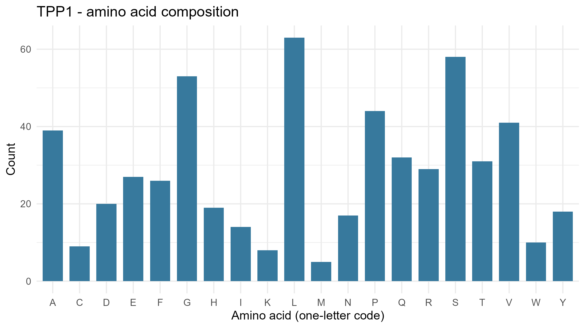
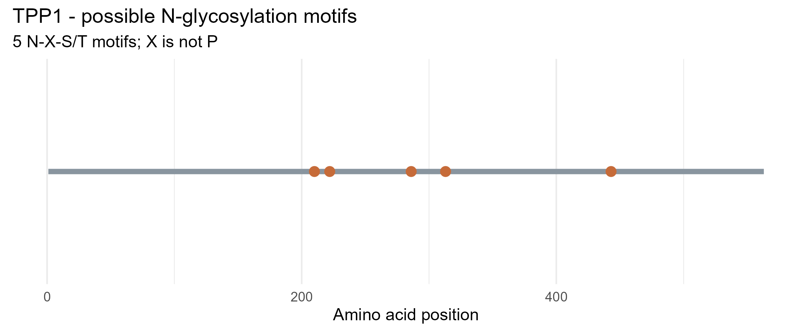

# Lysosomal enzyme analysis: Tripeptidyl-peptidase 1 (TPP1)

## Isabella Tuble - A - III

**Enzyme name:** Tripeptidyl-peptidase 1 (also called CLN2)

**Gene symbol:** TPP1

**NCBI protein record:** [NP_000382.3](https://www.ncbi.nlm.nih.gov/protein/NP_000382.3)

## Function

TPP1 is a lysosomal serine protease. Inside the lysosome it removes tripeptides (three amino acids at a time) from the N-terminus of proteins and peptides, helping break them down into pieces the cell can recycle. It is made as an inactive precursor and is activated in the acidic lysosome.

## Repository contents

| Path | Description |
|---|---|
| `lysosomal_enzyme_analysis.r` | R script used for the whole analysis |
| `data/TPP1.fasta` | Protein sequence downloaded from NCBI by the script |
| `results/TPP1_summary.csv` | Protein length and number of possible motifs |
| `results/TPP1_amino_acid_counts.csv` | Counts and percentages of each amino acid |
| `results/TPP1_motif_positions.csv` | Positions and sequences of N-X-S/T motifs |
| `figure/TPP1_amino_acid_composition.png` | Figure 1 |
| `figure/TPP1_potential_N_glycosylation.png` | Figure 2 |

---

## Workflow

### Step 1. Select the enzyme and find the accession

I chose **TPP1** from the list of protease genes. On the NCBI Protein database (https://www.ncbi.nlm.nih.gov/protein/) I searched `TPP1 Homo sapiens` and selected a full-length human RefSeq record (NP_ accession) instead of a partial sequence.

- Gene: TPP1
- Enzyme: Tripeptidyl-peptidase 1
- Accession: **NP_000382.3**

### Step 2. Set up R

I installed the required packages once in the R Console:

```r
install.packages(c("rentrez", "ggplot2"))
```

Then I edited only the first two lines of the script:

```r
gene <- "TPP1"
accession <- "NP_000382.3"
```

### Step 3. Download the sequence from NCBI using R

The script downloads the sequence directly from NCBI with the `rentrez` package (`entrez_fetch`), then saves it to `data/TPP1.fasta`. I did not copy the sequence by hand.

To confirm that the file came from NCBI, I printed the first lines of the saved file in R:

```r
cat(head(readLines("data/TPP1.fasta"), 4), sep = "\n")
```

Output:

```
NP_000382.3 tripeptidyl-peptidase 1 preproprotein [Homo sapiens]
MGLQACLLGLFALILSGKCSYSPEPDQRRTLPPGWVSLGRADPEEELSLTFALRQQNVERLSELVQAVSD
PSSPQYGKYLTLENVADLVRPSPLTLHTVQKWLLAAGAQKCHSVITQDFLTCWLSIRQAELLLPGAEFHH
YVGGPTETHVVRSPHPYQLPQALAPHVDFVGGLHRFPPTSSLRQRPEPQVTGTVGLHLGVTPSVIRKRYN
```

The first line is the FASTA header from NCBI. It contains the accession NP_000382.3.

### Step 4. Run the analysis script

I ran the whole script (`lysosomal_enzyme_analysis.r`) in RStudio, with the project folder as the working directory. The script finished without errors and printed:

```
Downloading NP_000382.3 from NCBI Protein...

Analysis complete for TPP1 (NP_000382.3)
  gene   accession length_amino_acids potential_N_glycosylation_motifs
1 TPP1 NP_000382.3                563                                5

Five most common amino acids:
 amino_acid count percent
          L    63   11.19
          S    58   10.30
          G    53    9.41
          P    44    7.82
          V    41    7.28

Files saved in data/, results/, and figures/.
```

### Step 5. Results

**Summary** (`results/TPP1_summary.csv`): the protein is **563 amino acids** long and has **5** potential N-glycosylation motifs.

**Most common amino acids** (`results/TPP1_amino_acid_counts.csv` has all 20): leucine (L), serine (S), glycine (G), proline (P) and valine (V), shown in the console output above.

**Potential N-glycosylation motifs** (`results/TPP1_motif_positions.csv`). The position is the location of the asparagine (N) in the motif:

| Position | Motif |
|---|---|
| 210 | NLT |
| 222 | NNS |
| 286 | NIS |
| 313 | NES |
| 443 | NAS |

### Step 6. Figures

**Figure 1.** Amino acid composition of TPP1. Leucine has the highest count, followed by serine, glycine, proline and valine, which matches the console output.



**Figure 2.** Positions of the 5 potential N-glycosylation motifs (N-X-S/T, X is not P) along the 563-residue protein. All five lie in the middle to C-terminal part of the sequence, and two of them (positions 210 and 222) are close together.



---

## Answers

### 1. What does your enzyme normally break down inside lysosomes?

TPP1 breaks down proteins and peptides. It is a tripeptidyl aminopeptidase, which means it cuts three amino acids at a time off the N-terminal end of its substrates. This turns partly degraded proteins into small fragments that can be broken down further and recycled.

### 2. What is the total length of your protein, and which amino acids are most common?

The TPP1 record (NP_000382.3) is 563 amino acids long. The most common amino acids are leucine (63, 11.19%), serine (58, 10.30%), glycine (53, 9.41%), proline (44, 7.82%) and valine (41, 7.28%). The least common are methionine and lysine (Figure 1). This is the full-length precursor, so it includes regions that are removed when the enzyme matures.

### 3. How many potential N-glycosylation motifs did you find? Where are they located?

I found 5 potential N-glycosylation motifs (N-X-S/T, where X is not proline). They start at positions 210 (NLT), 222 (NNS), 286 (NIS), 313 (NES) and 443 (NAS). All of them are in the middle to C-terminal part of the protein, with none in the first 200 residues. Two motifs lie close together at positions 210 and 222 (Figure 2).

### 4. Why can glycosylation matter for lysosomal proteins? Does finding a motif prove the protein is glycosylated?

Glycosylation helps lysosomal enzymes fold correctly, stay stable and avoid being degraded. In many lysosomal enzymes, the sugar chains are also modified with mannose-6-phosphate, a tag that is recognized by receptors in the Golgi so the enzyme is delivered to the lysosome instead of being secreted. Finding a motif does not prove glycosylation. N-X-S/T only shows that the sequence could be a site. Not every motif is used, and this analysis does not show whether a glycan is attached or whether a mannose-6-phosphate tag is present. That would need experimental evidence such as mass spectrometry or enzyme treatments.

### 5. What could happen in the cell if your enzyme did not work properly?

If TPP1 is missing or not working, its substrates are not broken down properly and they build up in lysosomes. This buildup damages cells, especially neurons. In people, TPP1 deficiency causes CLN2 disease (late-infantile neuronal ceroid lipofuscinosis, a type of Batten disease), a neurodegenerative disorder with seizures, loss of motor and language skills, vision loss and shortened lifespan. Sequence analysis alone does not measure enzyme activity, so these results cannot tell us how well TPP1 works.
